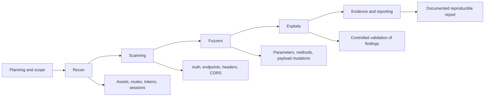
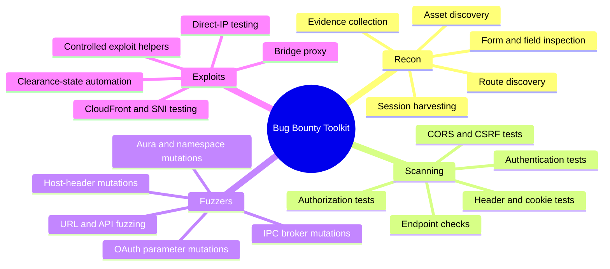
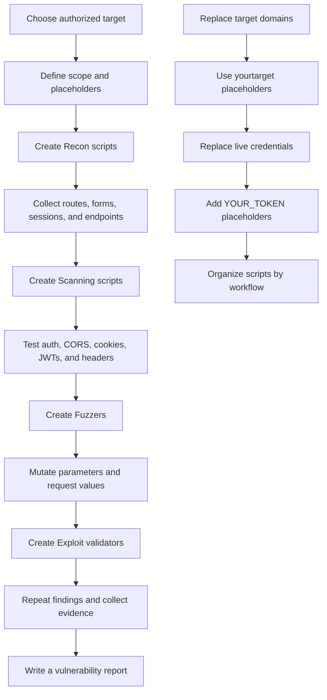
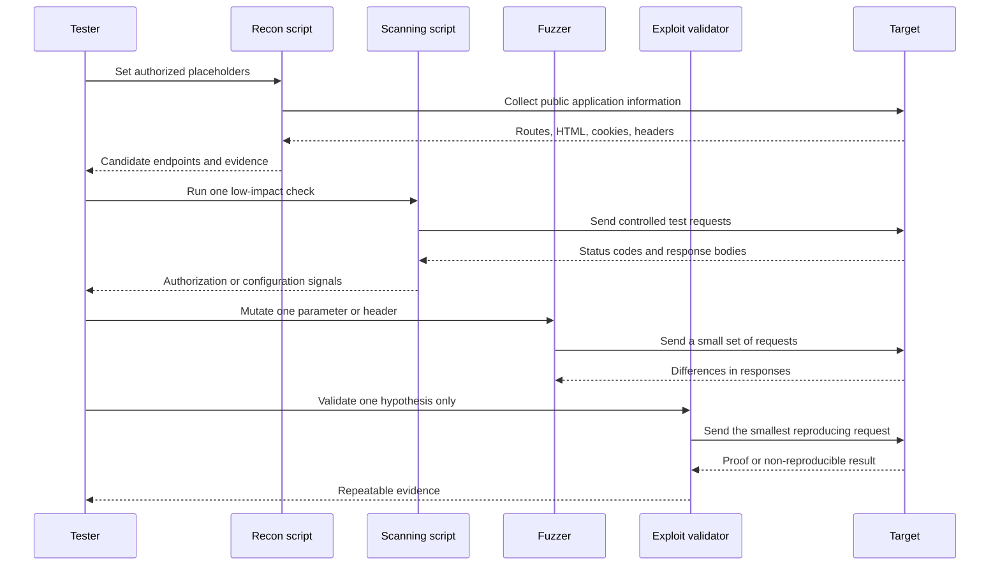
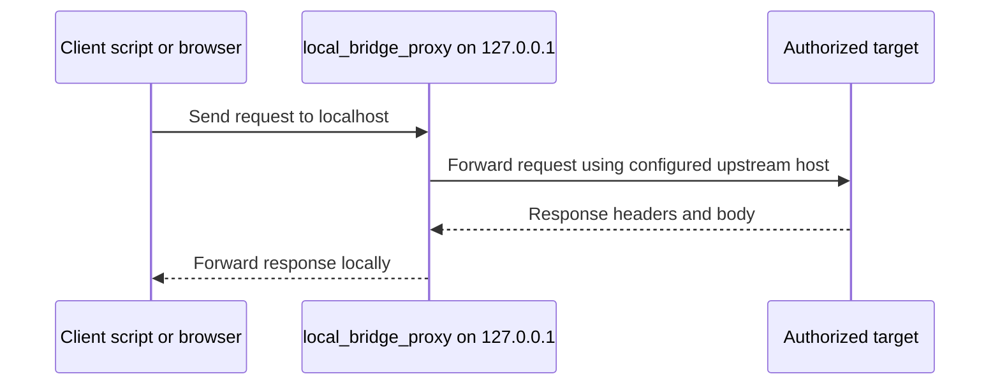
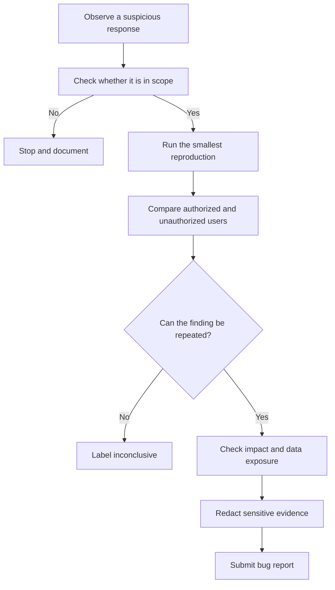
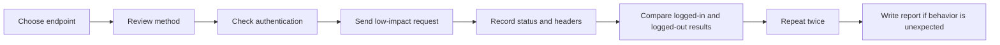

> [!IMPORTANT]
> **Transparency notice — secret scan**
>
> A repository pattern scan found **no obvious hardcoded secrets** in the currently tracked files. This is a limited text-pattern check, not verification of Git history, deleted files, environment variables, or runtime configuration.
>
> Credential-like filenames and APIs in this repository are development/reference code; no embedded secret value was identified. Always use placeholders, redact evidence, and verify secret handling before sharing or deploying.

A structured collection of Python and shell scripts for authorized reconnaissance, scanning, fuzzing, and exploitation practice. The toolkit is organized to help beginners understand which phase a [...]

# 100 Of My Own Bug Bounty Tools [Toolkit] Not Saturated - All My original code. Ive Used Them All, Ive made $ With Them All.

A structured collection of Python and shell scripts for authorized reconnaissance, scanning, fuzzing, and exploitation practice. The toolkit is organized to help beginners understand which phase a script belongs to, what it does, and how to run it safely.

> **Authorization required:** Use these tools only against systems you own or have written permission to test. Never test third-party targets without a valid bug bounty scope, rules of engagement, and explicit authorization.

## What This Toolkit Is For

The toolkit supports a typical authorized security assessment workflow:

1. Discover assets and entry points.
2. Inspect application behavior and authentication.
3. Scan for common vulnerabilities or misconfigurations.
4. Fuzz inputs and headers.
5. Validate findings and collect evidence.

Live target values have been replaced with placeholders:

- `https://yourtarget.com` — a normal target
- `https://api.yourtarget.com` — an API target
- `YOUR_TOKEN` — an authentication token placeholder
- `127.0.0.1` — a local-only service

## Toolkit at a Glance





## Folder Structure

| Folder | Purpose | Beginner guidance |
|---|---|---|
| `Recon/` | Find assets and collect information needed for testing | Start here after confirming scope |
| `Scanning/` | Check endpoints and identify likely security issues | Run low-impact checks first |
| `Fuzzers/` | Mutate parameters, headers, and routes | Use small, controlled request volumes |
| `Exploits/` | Validate specific weaknesses | Use only in authorized lab or program scope |
| `.venv/` | Optional local Python virtual environment | Usually ignored by Git |

## Complete File Guide

### Recon

Recon scripts collect target information, authentication state, routes, forms, and captured request evidence.

| File | What it does |
|---|---|
| `Recon/discover_api_upstream.py` | Discovers likely API upstream hosts and endpoint relationships |
| `Recon/discover_routes.py` | Requests candidate routes and records route behavior |
| `Recon/download_sheets.sh` | Downloads spreadsheet exports from placeholder-sheet URLs |
| `Recon/dump_all_cookies.py` | Uses Playwright to collect browser cookies |
| `Recon/dump_all_fields.py` | Extracts fields from a target form |
| `Recon/dump_all_forms_json.py` | Saves form structures and values as JSON |
| `Recon/dump_all_records.py` | Rebuilds and dispatches captured Aura record requests |
| `Recon/dump_token_page.py` | Downloads and parses a token-related page |
| `Recon/dump_user_tokens.py` | Searches user and token-related endpoints |
| `Recon/dump_validation_text.py` | Captures form validation and registration messages |
| `Recon/extract_api_keys.py` | Uses a browser session to inspect or extract exposed API-key material |
| `Recon/extract_endpoints.py` | Scrapes candidate endpoints from documentation or HTML |
| `Recon/extract_oauth_redirect.py` | Examines OAuth redirect and callback configuration |
| `Recon/harvest_records_v2.py` | Harvests data using an iterative captured Aura request variant |
| `Recon/harvest_records_v3.py` | Uses a refined request construction for Aura record harvesting |
| `Recon/harvest_records_v4.py` | Replaces a captured request parameter and sends follow-up requests |
| `Recon/harvest_records_v5.py` | Dispatches the latest captured request structure for record discovery |
| `Recon/harvest_session.py` | Starts or captures an authenticated session |
| `Recon/harvest_snapshots.py` | Visits pages and captures rendered browser state |
| `Recon/harvest_tokens.py` | Searches local evidence for token-like strings |
| `Recon/harvest_user_detail_final.py` | Harvests user-detail responses from a captured request |
| `Recon/inspect_captured.py` | Decodes or inspects a saved captured request |
| `Recon/inspect_entries.py` | Reviews JSON entries in collected evidence |
| `Recon/leak_scraper.py` | Extracts links and potential sensitive strings from pages |
| `Recon/live_session_harvester.py` | Uses Playwright to collect an active browser session |
| `Recon/map_controllers_to_actions.py` | Maps bundled Salesforce/Aura controllers to actions |
| `Recon/native_xhr_replay.py` | Replays native browser XHR requests |
| `Recon/okta_recon_probe.py` | Checks login and redirect behavior |
| `Recon/tenant_harvest.py` | Uses tenant context to collect application data |
| `Recon/thuringer_sweep.sh` | Runs a shell-based reconnaissance sweep |
| `Recon/track_redirects.py` | Tracks redirect chains and OAuth callback behavior |
| `Recon/verify_access.py` | Verifies whether selected account endpoints respond |
| `Recon/verify_fresh_session.py` | Confirms whether a newly collected session remains valid |
| `Recon/verify_login_session.py` | Tests login-session behavior and follow-up requests |

### Scanning

Scanning scripts check many endpoints or authentication states and usually report HTTP status or response differences.

| File | What it does |
|---|---|
| `Scanning/dispatch_harvested_session.py` | Sends harvested session data through the local bridge |
| `Scanning/mass_balancer.py` | Uses concurrent requests to inspect balances or availability |
| `Scanning/test_adyen_endpoints.py` | Tests representative Adyen/payment endpoints |
| `Scanning/test_auth_api.py` | Sends requests to check API authorization behavior |
| `Scanning/test_auth_bypass.py` | Tries invalid, malformed, and alternate authorization headers |
| `Scanning/test_auth_matrix.py` | Compares accounts across endpoints and authorization modes |
| `Scanning/test_bearer_auth.py` | Tests bearer-token access to selected endpoints |
| `Scanning/test_bola_final.py` | Runs a final BOLA/IDOR-style request set |
| `Scanning/test_bola_submission.py` | Tests object submission authorization |
| `Scanning/test_bola_success.py` | Probes whether a likely object-level authorization flaw succeeds |
| `Scanning/test_bridge_assault.py` | Sends multiple route requests through the bridge |
| `Scanning/test_bypass.py` | Tests host, cache, and route bypass techniques |
| `Scanning/test_cffi.py` | Checks `curl_cffi` request compatibility |
| `Scanning/test_clearance.py` | Automates browser clearance checks and asset requests |
| `Scanning/test_cookie_auth.py` | Tests account actions using cookies |
| `Scanning/test_cookie_csrf.py` | Compares cookie-based and CSRF-related request behavior |
| `Scanning/test_cookie_only.py` | Tests endpoint access using only cookies |
| `Scanning/test_correct_domain.py` | Checks whether requests are sent to the correct host |
| `Scanning/test_cors.py` | Tests whether CORS accepts suspicious origins |
| `Scanning/test_csrf_header.py` | Tests whether CSRF headers are enforced |
| `Scanning/test_endpoints.py` | Checks a list of endpoints and records response states |
| `Scanning/test_extracted_client.py` | Tests an extracted OAuth client against callbacks |
| `Scanning/test_file_jwt.py` | Reads a JWT file and uses it for authorization tests |
| `Scanning/test_full_cookie.py` | Tests endpoints using a complete browser cookie string |
| `Scanning/test_hmac_auth.py` | Generates and tests HMAC authentication headers |
| `Scanning/test_host_injection.py` | Tests Host-header or forwarded-host handling |
| `Scanning/test_ip_spoof.py` | Tests whether IP-related headers affect authorization |
| `Scanning/test_jwt_bola.py` | Combines JWT authorization with BOLA-style object checks |
| `Scanning/test_learning_auth_redirect.py` | Tests redirect parameters for open redirect behavior |
| `Scanning/test_method_override.py` | Checks HTTP method override headers |
| `Scanning/test_method_override_post.py` | Checks method override behavior in POST requests |
| `Scanning/test_orders_auth.py` | Tests authorization around order endpoints |
| `Scanning/test_p1_privilege_escalation.py` | Tests likely privilege-escalation request paths |
| `Scanning/test_priv_forms.py` | Enumerates private or privileged form identifiers |
| `Scanning/test_sanitized_jwt.py` | Tests a split or sanitized JWT value |
| `Scanning/test_session_tokens.py` | Checks session and token access to selected endpoints |
| `Scanning/test_telemetry.py` | Tests telemetry or settings endpoints |
| `Scanning/test_timeout_diagnostics.py` | Measures timeouts and network failure behavior |
| `Scanning/test_token_scope.py` | Checks what a token can access |
| `Scanning/test_user_cookies.py` | Builds cookie matrices and sends endpoint requests |
| `Scanning/test_utxo_array.py` | Tests UTXO endpoint response arrays |
| `Scanning/test_utxo_debug.py` | Debugs UTXO endpoint requests and responses |

### Fuzzers

Fuzzers mutate URL components, headers, methods, parameters, controllers, or request values.

| File | What it does |
|---|---|
| `Fuzzers/direct_sni_fuzz.py` | Tests direct-IP connections with different SNI values |
| `Fuzzers/fuzz_cases.py` | Sends mutated Aura case payloads |
| `Fuzzers/fuzz_case_component.py` | Fuzzes case-component descriptors and values |
| `Fuzzers/fuzz_core_domain.py` | Sends variations across core target endpoints |
| `Fuzzers/fuzz_csrf_gateway.py` | Mutates CSRF gateway requests |
| `Fuzzers/fuzz_host_headers.py` | Tests different Host and forwarding headers |
| `Fuzzers/fuzz_ipc_broker.py` | Sends structured mutations to an IPC socket |
| `Fuzzers/fuzz_ip_spoof.py` | Fuzzes IP-spoof and forwarding header combinations |
| `Fuzzers/fuzz_namespaces.py` | Mutates Aura namespaces and controller names |
| `Fuzzers/fuzz_oauth_params.py` | Fuzzes OAuth client, response, and redirect parameters |
| `Fuzzers/fuzz_remote_actions.py` | Tests remote action and administrative endpoints |
| `Fuzzers/live_bounty_fuzz.py` | Sends a controlled set of live endpoint mutations |
| `Fuzzers/test_authenticated_fuzz.py` | Fuzzes a target while carrying an authenticated session |

### Exploits

These scripts may contain higher-impact checks. Run them only when a finding is explicitly authorized and supported by scope rules.

| File | What it does |
|---|---|
| `Exploits/dontaskmehow-special.sh` | Large shell catalog for recon, scanning, exploit validation, and reporting |
| `Exploits/exploit_cloudflare_bypass.py` | Sends browser-like requests through alternate routing methods |
| `Exploits/exploit_cloudfront_follow.py` | Tests CloudFront Origin and redirect behavior |
| `Exploits/exploit_cloudfront_parser.py` | Sends direct socket requests against a CloudFront hostname |
| `Exploits/exploit_cloudfront_sni.py` | Tests SNI routing with direct socket connections |
| `Exploits/exploit_direct_ip.py` | Tests an IP address directly while sending target Host and SNI values |
| `Exploits/grantu.py` | CLI helper for a targeted exploit workflow |
| `Exploits/grantuip.py` | IP-oriented exploit and validation helper |
| `Exploits/grantu_omega.py` | Expanded concurrent exploit workflow |
| `Exploits/local_bridge_proxy.py` | Runs a local HTTP bridge that forwards requests upstream |
| `Exploits/update_clearance.py` | Uses a browser to refresh or update clearance state |
| `Exploits/url_double_encode_null.py` | Sends double-encoded and null-related URL mutations |

## How It Was Built



The toolkit was designed around four important ideas:

1. **Separate each assessment phase.** Recon collects information, scanning checks it, fuzzers mutate inputs, and exploits validate stronger hypotheses.
2. **Keep target details replaceable.** Scripts use generic placeholders so they can be reviewed or shared without exposing a live target.
3. **Keep changes small and reproducible.** Most scripts send one request type, record a response, or compare several variants.
4. **Prefer evidence over assumptions.** Status codes, response bodies, redirects, and headers are recorded before labeling an issue as exploitable.

## Basic Concepts

| Term | Plain-English meaning |
|---|---|
| Recon | Gathering information about the target |
| Scanning | Automatically checking many endpoints or configurations |
| Fuzzing | Sending many slightly different inputs to find unexpected behavior |
| Endpoint | A URL that accepts or returns application data |
| Header | Metadata sent with an HTTP request |
| Cookie | A browser-stored token used by the website |
| JWT | A token format that represents an encoded signed session or identity |
| CORS | Rules controlling which websites can call an API |
| CSRF | Request forgery that abuses an authenticated browser session |
| BOLA/IDOR | Authorization flaws that allow access to another user's object |
| SNI | The hostname a client asks a TLS server to serve |
| Origin | The scheme, hostname, and port of a web application |
| 2FA/MFA | A second authentication step |

## Before You Begin

### 1. Confirm authorization

Only test assets explicitly listed in the bug bounty program or included in your written scope. Check:

- Allowed domains and subdomains
- Allowed IP ranges
- Whether testing tools or automated scanning are restricted
- Request-rate limits
- Forbidden actions
- Required reporting process

### 2. Install Python

Python 3.10 or newer is recommended.

```powershell
python --version
```

### 3. Create a virtual environment

```powershell
cd C:\path\to\Bountykit-github
python -m venv .venv
.\.venv\Scripts\Activate.ps1
python -m pip install --upgrade pip
```

### 4. Install dependencies

Create or install a workspace-wide requirements file:

```powershell
pip install -r requirements.txt
python -m playwright install
```

Typical Python dependencies used by the toolkit are:

- `requests`
- `httpx`
- `curl-cffi`
- `playwright`
- `beautifulsoup4`
- `aiohttp`
- `tqdm`

## Runtime Workflow



## Editing a Script Safely

Most scripts contain a target variable near the top. Replace it with the correct authorized target:

```python
BASE_URL = "https://yourtarget.com"
TARGET_URL = "https://api.yourtarget.com/v1/example"
```

Replace credential placeholders similarly:

```python
TOKEN = "YOUR_TOKEN"
COOKIE = "YOUR_COOKIE"
API_KEY = "YOUR_API_KEY"
API_SECRET = "YOUR_API_SECRET"
```

Do not commit real tokens, session cookies, private keys, API secrets, or evidence containing personal data.

## Runtime Examples

Run a script from the repository root:

```powershell
python Recon\discover_routes.py
python Recon\extract_endpoints.py
python Recon\dump_all_cookies.py
```

Scanning examples:

```powershell
python Scanning\test_auth_api.py
python Scanning\test_cors.py
python Scanning\test_cookie_auth.py
python Scanning\test_host_injection.py
python Scanning\test_method_override.py
python Scanning\test_endpoints.py
```

Fuzzer examples:

```powershell
python Fuzzers\fuzz_core_domain.py
python Fuzzers\fuzz_host_headers.py
python Fuzzers\fuzz_oauth_params.py
python Fuzzers\direct_sni_fuzz.py
```

Exploit-validation examples should be run only with explicit authorization:

```powershell
python Exploits\exploit_direct_ip.py
python Exploits\exploit_cloudfront_sni.py
python Exploits\local_bridge_proxy.py
```

Shell scripts:

```powershell
bash Recon/download_sheets.sh
bash Recon/thuringer_sweep.sh
bash Exploits/dontaskmehow-special.sh
```

On Windows, run shell scripts from Git Bash or WSL. Review them first because `dontaskmehow-special.sh` contains many external tool commands.

## Using the Local Bridge

The local bridge is useful when a script or browser needs a local translation point.



Start the bridge:

```powershell
python Exploits\local_bridge_proxy.py
```

Default local address:

```text
http://127.0.0.1:8888
```

Then run a bridge-assisted script in another terminal:

```powershell
python Scanning\test_bridge_assault.py
python Scanning\dispatch_harvested_session.py
```

## Browser-Based Scripts

Some scripts use Playwright. Install Chromium once:

```powershell
python -m playwright install chromium
```

Browser examples:

- `Recon/dump_all_cookies.py`
- `Recon/dump_all_forms_json.py`
- `Recon/live_session_harvester.py`
- `Recon/harvest_snapshots.py`
- `Scanning/test_clearance.py`
- `Exploits/update_clearance.py`

If a browser script cannot find Chromium, run:

```powershell
python -m playwright install
```

## Evidence Collection

Recommended evidence structure:

```text
Evidence/
  requests/
  responses/
  screenshots/
  redirects/
  headers/
  reports/
```

For each finding, save:

- URL
- HTTP method
- Request headers
- Request body
- Response status
- Key response headers
- Relevant response excerpt
- Timestamp
- Screenshot if useful
- Exact reproduction steps

Redact secrets before saving or committing evidence.

## Example Finding Workflow



## Beginner Example: Test CORS Safely

1. Open `Scanning/test_cors.py`.
2. Replace `url` with an authorized API endpoint.
3. Review the Origin values.
4. Run the script:

```powershell
python Scanning\test_cors.py
```

5. Look for:

- `Access-Control-Allow-Origin` returned for an unexpected origin
- `Access-Control-Allow-Credentials: true`
- Reflections of attacker-controlled origins

A permissive CORS response is a lead, not proof of exploitability. Verify it in a browser or with controlled accounts.

## Beginner Example: Test an Endpoint



## Interpreting Results

| Result | Meaning |
|---|---|
| `200 OK` | Request succeeded; not automatically a vulnerability |
| `401 Unauthorized` | No valid authentication was presented |
| `403 Forbidden` | Authentication exists, but the action is denied |
| `404 Not Found` | Resource, route, or object may not exist |
| `301/302 Redirect` | Request moved to another URL |
| `500 Server Error` | Server encountered an error; may reveal input handling |
| Different body on repeated tests | Candidate behavior deserves manual review |
| Full user data returned | Potential information exposure; verify with authorized accounts |

## Dependency Note

The scripts use a mix of standard-library modules and third-party libraries:

- Python standard library
- `requests`
- `httpx`
- `curl-cffi`
- `playwright`
- `beautifulsoup4`
- `aiohttp`
- `tqdm`

Some scripts invoke external tools such as Nmap, Nuclei, FFuf, SQLMap, Katana, Nuclei, OWASP ZAP, or browser utilities. Those tools must be installed separately when used.

## Repository Recommendations

Before publishing or sharing this repository:

- Commit a root `requirements.txt` or `pyproject.toml`
- Add a `.gitignore` for `.venv/`, evidence, screenshots, cookies, and tokens
- Add a `LICENSE` appropriate for the repository owner
- Add `CONTRIBUTING.md` with scope and safety rules
- Replace all live cookies and personal values with placeholders
- Do not commit browser profiles or local session state
- Add tests or smoke checks for non-network code paths
- Pin dependency versions for reproducible environments

## Security and Privacy

Never include:

- Real bearer tokens
- API keys or secret keys
- Browser session cookies
- Personal account details
- Private IP ranges
- Captured evidence containing customer data
- Valid production passwords

Use placeholders such as:

```text
YOUR_TOKEN
YOUR_COOKIE
YOUR_API_KEY
YOUR_API_SECRET
YOUR_SESSION_ID
https://yourtarget.com
https://api.yourtarget.com
```

## Troubleshooting

| Problem | Likely solution |
|---|---|
| `ModuleNotFoundError` | Activate `.venv` and install `requirements.txt` |
| Playwright browser missing | Run `python -m playwright install chromium` |
| TLS or certificate errors | Confirm proxy settings and authorized target configuration |
| Connection timeout | Check scope, network access, and URL placeholder values |
| Script uses no target | Replace placeholder URLs and hostnames |
| Authentication returns `401` | Replace `YOUR_TOKEN` or cookie placeholders |
| Script returns too many errors | Lower concurrency and verify endpoint paths |
| Import path `lib.core.enums` is missing | Install or replace the expected local module before running that script |

## Recommended Safe Lab

For learning, use a local lab or explicitly authorized practice target:

- OWASP Juice Shop
- PortSwigger Web Security Academy
- Hack The Box Academy labs
- TryHackMe labs
- Your own intentionally vulnerable application

Keep local services separate from public targets and never point these scripts at an unknown host.

## Contributing

1. Create a branch for the new script or documentation.
2. Place the script in the correct folder.
3. Replace live domains and credentials with placeholders.
4. Document required arguments and expected output.
5. Add a low-rate or offline example if possible.
6. Review it for secrets before committing.

## License

Choose a license before distributing this repository. Until one is added, no license is granted by default.
