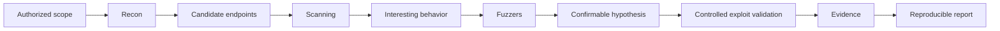
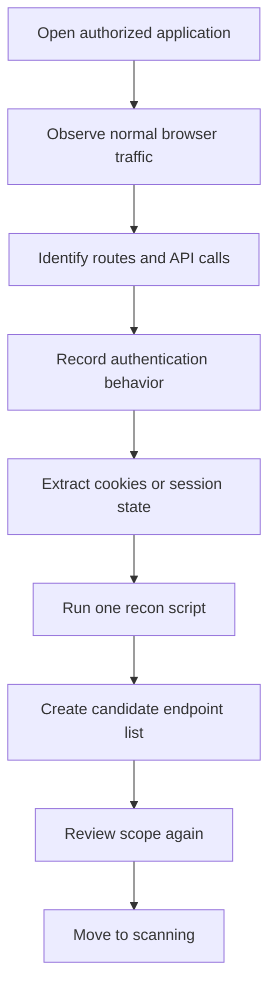
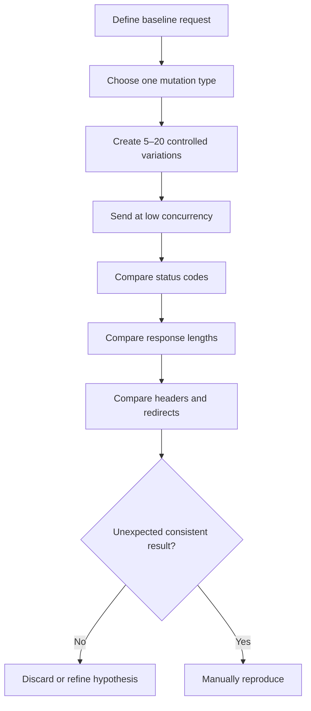
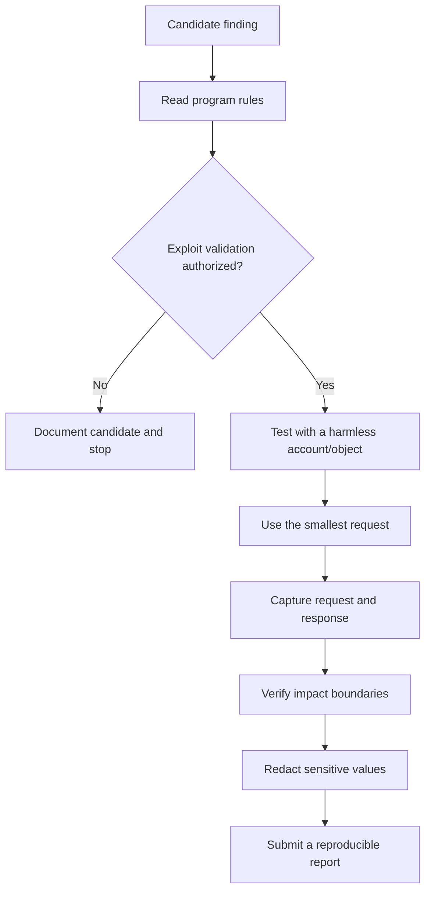
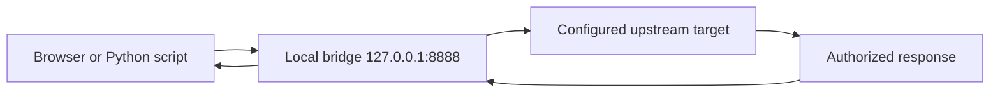
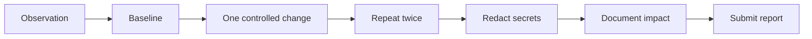

# I Turned My Bug-Bounty Workflow Into a Free 100+ Script Toolkit

> **Free for the community. Built from real work. Designed for authorized security testing.**

Bug bounty hunting has a funny relationship with time: every minute spent rebuilding a script is a minute not spent understanding an application. For years, I collected small scripts for discovery until I just said fuck it and coded my own arsenal for, authorization checks, CORS testing, session replay, browser automation, fuzzing, direct-IP validation, OAuth checks, and evidence collection and many many more to be dropped it this gets the attention it should(Respectfully).

This repository is my attempt to organize that work into a single toolkit for other security researchers. It is not a magic “find bugs” button. It is a practical collection of focused utilities—built for people who already own a computer chair and, apparently, plan to spend a lot of time in it.

And yes, the joke is intentional. If you have ever been on a bounty for twelve hours, you understand why a programmer might need to stop and appreciate the chair.

## The Real Goal

My goal was simple:

- Stop recreating the same helper scripts
- Start from a consistent folder structure
- Keep recon information, auth tests, fuzzers, and exploit validators separate
- Replace live domains and credentials before sharing anything
- Collect enough evidence to reproduce a finding
- Make the workflow understandable to a beginner
- Give back a working toolkit to the community for free

Over multiple authorized bounty engagements, this workflow helped me earn **$8,000 in two weeks**. That number is meaningful, but it is not normal or guaranteed. Bug bounty income varies dramatically with scope, timing, skill, competition, and luck. The tools did not create the result alone—the repeatable process and careful verification did.

## What Is Inside?

The repository contains approximately **100 Python and shell utilities**, divided into four clear phases:

| Folder | Role | Examples |
|---|---|---|
| [`Recon/`](./Recon/) | Discover routes, endpoints, sessions, forms, and application state | Cookie extraction, route discovery, OAuth redirect discovery, endpoint scraping |
| [`Scanning/`](./Scanning/) | Check authentication, authorization, headers, CORS, CSRF, and endpoint behavior | JWT tests, BOLA tests, cookie tests, HMAC tests, CORS checks |
| [`Fuzzers/`](./Fuzzers/) | Mutate parameters, hosts, methods, namespaces, and OAuth values | Host-header fuzzing, IP spoofing, direct-SNI fuzzing, Aura payload mutation |
| [`Exploits/`](./Exploits/) | Validate selected weaknesses and alternate routing behavior | Direct-IP checks, CloudFront/SNI checks, local bridge, clearance automation |



## The Toolkit Workflow

A strong security workflow should begin small. Every script in this repository should represent a repeatable question:

- Can this endpoint identify whether a user is authenticated?
- Does it accept cookies in an unexpected way?
- Does CORS permit another origin?
- Can one account access another account's object?
- Does the server trust a forwarded hostname?
- Is the response different after a parameter mutation?
- Is a redirect validated or simply reflected?

A good answer is not “it returned 200.” A good answer is a controlled, repeatable result with a baseline, one changed variable, and evidence that proves impact.

```mermaid
sequenceDiagram
    participant T as Tester
    participant R as Recon
    participant S as Scanning
    participant F as Fuzzer
    participant X as Exploit validator
    participant A as Authorized target

    T->>R: Confirm scope and start collection
    R->>A: Send low-impact discovery requests
    A-->>R: HTML, routes, cookies, headers
    R-->>T: Candidate assets and endpoints

    T->>S: Test one authorization or configuration behavior
    S->>A: Send controlled baseline requests
    A-->>S: Status codes and response differences
    S-->>T: Finding candidate

    T->>F: Mutate one parameter or header
    F->>A: Send a limited set of variations
    A-->>F: Response variations

    T->>X: Reproduce only the strongest hypothesis
    X->>A: Send the smallest proof request
    A----X: Response or data access
    X-->>T: Evidence for a report
```

## Reconnaissance Scripts

Recon is not about collecting everything. It is about collecting the smallest useful set of facts.

The `Recon/` folder includes scripts for:

- Discovering API upstream names
- Finding application routes
- Reading forms and validation text
- Capturing browser cookies
- Harvesting snapshots and sessions
- Extracting OAuth redirects
- Reviewing exposed endpoints
- Mapping controllers and actions
- Collecting and inspecting evidence
- Verifying whether a session is still fresh

### Recon and a real assessment

Start with a browser and a low-impact script. Record the normal login flow, inspect the Network panel, identify API endpoints, and save representative headers. Then use a recon script to repeat or extend that process.



## Scanning Scripts

The `Scanning/` folder compares request states instead of assuming a request is vulnerable.

It includes tests for:

| Category | Scripts test |
|---|---|
| Authentication | Bearer tokens, JWTs, cookies, HMAC, and session files |
| Authorization | BOLA/IDOR, privilege escalation, account endpoints, and object access |
| Browser behavior | CORS, CSRF headers, cookie-only access, method overrides |
| Infrastructure | Host headers, forwarded IP values, domains, and endpoint routes |
| API behavior | JWT scope, endpoint status, transaction order, telemetry, and tokens |

A useful testing matrix looks like this:

| Test | Account A | Account B | Anonymous |
|---|---|---|---|
| Public endpoint | 200 | 200 | 200 |
| Account settings | 200 | 403 | 401 |
| Object owned by A | 200 | 403 | 401 |
| Object owned by B | 403 | 200 | 401 |

A finding becomes more credible when the script demonstrates exactly which rows differ and why.

## Fuzzer Scripts

Fuzzers send variations to identify unexpected behavior. The repository includes mutation tools for:

- Aura case components and payloads
- OAuth response types and redirect parameters
- Host and forwarded-IP headers
- Core API paths
- Remote actions and namespaces
- IPC broker messages
- Direct-IP SNI routing
- Authenticated request parameters



Fuzzing is most effective when the mutation set is small enough to understand. A successful random payload does not explain an issue. A result is useful when you can show the exact field that changed and the exact response that changed with it.

## Exploit Validation Scripts

The `Exploits/` folder contains higher-impact validators for alternate routing and controlled technical validation:

- Cloudflare and CloudFront routing tests
- Direct-IP OAuth requests
- CloudFront SNI checks
- A local translation bridge
- Browser clearance automation
- URL encoding and plugin-style mutation helpers

These scripts should be used only under explicit authorization. A direct-IP script can make the request appear to come from a different virtual host. A bridge can forward requests to a target. A shell catalog can invoke many external tools.



## How to Install It

### Requirements

- Python 3.10 or newer
- Windows, Linux, macOS, WSL, or Git Bash
- A virtual environment
- Playwright browser binaries for browser scripts
- External command-line tools only when a shell script explicitly requires them

### Windows setup

```powershell
cd C:\path\to\Bountykit-github
python -m venv .venv
.\.venv\Scripts\Activate.ps1
python -m pip install --upgrade pip
pip install -r requirements.txt
python -m playwright install chromium
```

### Linux or macOS setup

```bash
cd /path/to/Bountykit-github
python3 -m venv .venv
source .venv/bin/activate
python -m pip install --upgrade pip
pip install -r requirements.txt
python -m playwright install chromium
```

Workspace-wide dependencies include:

| Package | Purpose |
|---|---|
| `requests` | General HTTP requests |
| `httpx` | Modern synchronous and asynchronous HTTP |
| `curl-cffi` | Browser-like HTTP and TLS fingerprints |
| `playwright` | Browser automation and session capture |
| `beautifulsoup4` | HTML parsing |
| `aiohttp` | Concurrent asynchronous requests |
| `tqdm` | Progress bars |

## Running a Script

From the repository root:

```powershell
python Recon\discover_routes.py
python Recon\dump_all_cookies.py
python Scanning\test_cors.py
python Fuzzers\fuzz_host_headers.py
python Exploits\local_bridge_proxy.py
```

Every script has its own assumptions. Read the top of the file before running it. Replace target variables and credential placeholders with authorized values.

```python
BASE_URL = "https://yourtarget.com"
TARGET_URL = "https://api.yourtarget.com/v1/example"
TOKEN = "YOUR_TOKEN"
COOKIE = "YOUR_COOKIE"
```

Before Git sharing, search for live data:

```bash
grep -RInE 'eyJ[A-Za-z0-9_-]+\.|YOUR_REAL_TOKEN|YOUR_REAL_COOKIE' \
  --include='*.py' --include='*.md' --include='*.sh' .
```

## Local Bridge Example

Some scripts send requests through `127.0.0.1:8888` before forwarding them to an authorized target.

```powershell
python Exploits\local_bridge_proxy.py
```

Then, in a second terminal:

```powershell
python Scanning\test_bridge_assault.py
python Scanning\dispatch_harvested_session.py
```



## Evidence Beats Confidence

A report should answer a reviewer faster than they can ask the next question.

For every finding, save:

| Evidence item | Example |
|---|---|
| Target URL | An authorized endpoint only |
| HTTP method | `GET`, `POST`, `OPTIONS`, or another method |
| Account context | Account A, Account B, or anonymous |
| Request headers | Redacted authorization and cookies |
| Request body | Redacted object or test values |
| Response status | `200`, `403`, `401`, or another status |
| Response excerpt | A short, relevant excerpt |
| Expected behavior | What the application should do |
| Actual behavior | What the application did |
| Reproduction steps | Numbered and repeatable |
| Impact | What an authorized attacker could access |



## Why Organization Matters

A large toolkit is useless if nobody knows which script belongs to which phase. The folder names provide a mental model:

1. **Recon** asks: “What exists?”
2. **Scanning** asks: “What behavior differs?”
3. **Fuzzers** ask: “What happens with mutations?”
4. **Exploits** ask: “Can we validate impact safely?”

That structure is more valuable than simply placing every script in one directory. It helps a beginner think like a tester instead of randomly executing network tools.

## Beginner's Recommended Path

| Day | Activity |
|---|---|
| Day 1 | Read scope, set up Python, activate the virtual environment |
| Day 2 | Run one recon script against an authorized lab |
| Day 3 | Inspect the request and response manually |
| Day 4 | Run one low-impact scanning script |
| Day 5 | Compare authenticated and unauthenticated results |
| Day 6 | Run a small fuzzer with 5–10 variations |
| Day 7 | Document one reproducible finding |

Do not skip the manual part. Automation creates hypotheses. Manual testing proves impact.

## Safety Rules

- Always confirm written authorization.
- Read every program scope and rate limit.
- Keep concurrency low.
- Never use real customer accounts or production data unless explicitly allowed.
- Never commit live tokens or cookies.
- Replace public domains with `yourtarget.com` and API domains with `api.yourtarget.com`.
- Stop when the scope ends or a system begins behaving unexpectedly.
- Do not test only for the sake of testing. Test for evidence and impact.

## Troubleshooting

| Problem | Likely fix |
|---|---|
| `ModuleNotFoundError` | Activate `.venv` and run `pip install -r requirements.txt` |
| `No module named curl_cffi` | Run `python -m pip install curl-cffi` |
| Playwright executable missing | Run `python -m playwright install chromium` |
| `401 Unauthorized` | Replace `YOUR_TOKEN` or refresh the session |
| `403 Forbidden` | Check authorization scope and account role |
| `Timeout` | Reduce concurrency and verify the endpoint |
| SSL certificate error | Check proxies, clock, SNI, and target configuration |
| Script still uses a placeholder | Replace target variables near the top of the file |
| `lib.core.enums` missing | The SQLMap-style plugin needs an external SQLMap source environment |

For detailed setup, browser, shell, proxy, and secret-handling help, use [`Help.md`](./Help.md).

## A Small Thank-You to the Bug-Hunters

This project is a practical thank-you to researchers who spend hours reading JavaScript bundles, replaying requests, comparing account roles, reviewing redirects, documenting edge cases, and writing reports that nobody can ignore.

It is also a thank-you to the people who work in a single chair for hours. You do not have to be a professional with a perfect lab. You need curiosity, patience, and respect for the scope.

The toolkit is free because knowledge should travel. It is open to improvement because no single workflow is complete. Every useful result, safe contribution, and better reproduction step makes it more valuable.

## Final Checklist

Before running or publishing:

- [ ] Scope is confirmed
- [ ] Target placeholders are configured
- [ ] Tokens and cookies are placeholders
- [ ] Virtual environment is active
- [ ] Dependencies are installed
- [ ] Playwright browser is installed if needed
- [ ] Concurrency is low
- [ ] Evidence folder excludes secrets
- [ ] Browser profiles and session files are ignored
- [ ] Every finding has reproduction steps
- [ ] No live target or personal data is committed

## Repository Files

| File | Purpose |
|---|---|
| `README.md` | Full toolkit guide, setup, workflow, and file explanations |
| `Help.md` | Troubleshooting for setup and runtime problems |
| `requirements.txt` | Workspace-wide Python dependencies |
| `Recon/` | Asset and session discovery |
| `Scanning/` | Authentication and endpoint checks |
| `Fuzzers/` | Parameter and header mutation |
| `Exploits/` | Controlled exploit validation |

## Final Thought

A security researcher earns trust by using tools carefully. The best toolkit is not the loudest or fastest—it is the one that helps you ask a precise question, isolate a changed variable, repeat the result, and explain the impact clearly.

Use the scripts responsibly. Replace the placeholders. Respect the scope. Document the evidence. And send a good report.

If this toolkit helps one person find a reproducible issue or avoid rebuilding the same script, it has done its job.
